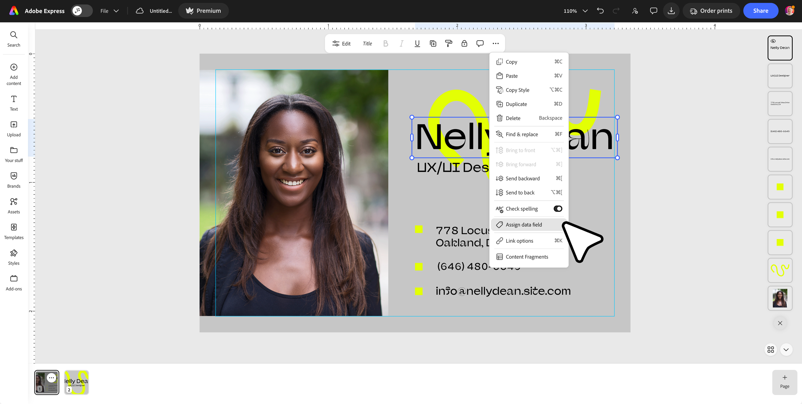
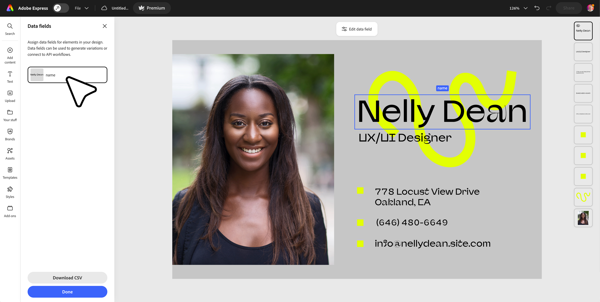
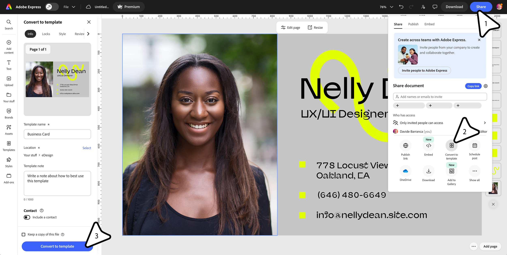

# Tag Elements in your Documents

Tag elements in your Adobe Express documents to update them programmatically via the Express API.

## Overview

Adobe Express uses **Data Fields** to let you identify specific document elements for API-driven automation. This guide walks you through setting them up and integrating them into your workflows.

<InlineAlert variant="info" slots="header, text" />

#### The Tag Elements Add-on

Previously, tagging elements required a dedicated add-on. This **functionality is now built directly into Adobe Express**. We encourage developers to adopt the native implementation, as the add-on will no longer be maintained.

## Assign Data Fields to Elements

Start by creating a document in Adobe Express, or open an existing Template that you want to customize. When the design is ready, you can begin assigning **Data fields** (i.e., tags) to the elements that you plan to update programmatically via Express API. At the moment, you can only tag **text**, **images**, and **videos**.

1. Select the element that you want to tag.
2. Either:
   - Right-click on the element and select **Assign data field** from the context menu.
   - Click the **•••** menu in the HUD and select **Assign data field**.



The **Data fields** left-hand panel will allow you to type the tag's label for the selected element. Please note that the tag will appear on the element itself immediately after being added, and a **Edit data field** HUD will be shown above the design for further modifications.



With the Data fields panel open, you can keep tagging other elements: just select them, and click **Assign data field** in the HUD.


Click the **Done** button when you're finished tagging all the elements in the page. You can now switch to the next page to add additional tags, or proceed to use the Express API to programmatically replace the tagged elements.

## Additional Information

- **Tags**:
  - You can tag as many elements as required in your replacement workflow.
  - Tag names must be unique within a single page, but the same tag name can be used for distinct elements on different pages. All tags with the same name will be swapped out with the same element in any replacement flow.

- **Viewing tagged elements**:
  - Select and right-click on any text, image, or video element: if a tag was previously assigned, you'll see an **Edit data field** option in the context menu, otherwise you'll find **Assign data field**. Select either option to open the Data field panel and inspect the list of tagged elements.

- **Using tags in API workflows**:
  - Once you have completed tagging, these tags can be referenced in your Express API-enabled workflow to programmatically swap out elements in seconds.
  - Unless you have started with an existing template,
  - The identifier (URN) of the tagged document can always be found in the Browser's URL bar:

  ```
  https://express.adobe.com/id/urn:aaid:sc:...
                               👆👆👆👆👆👆👆👆👆
  ```

  - If you have started with a brand new document (not based on an existing template), you will need to click the **Share** button and select **Convert to template** in the share menu on the right. This allows you to give the template a name, lock permanently elements, link brands or libraries, and more. Click again **Convert to template** in the left-hand panel to finalize the conversion.

  
